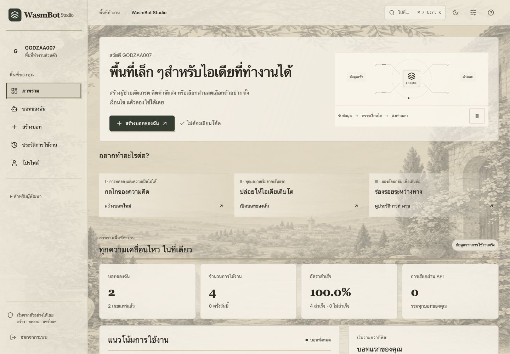
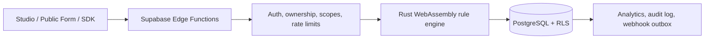

# WasmBot Studio

**แพลตฟอร์มสร้าง Business Logic Bot แบบไม่ต้องเขียนโค้ด ขับเคลื่อนด้วย Rust WebAssembly และออกแบบให้พร้อมใช้งานจริง**

[](https://wasmbot-studio.vercel.app)
[](https://react.dev/)
[](https://www.typescriptlang.org/)
[](https://www.rust-lang.org/)
[](https://supabase.com/)



WasmBot Studio ช่วยให้ผู้ใช้ที่ไม่ใช่นักพัฒนาสามารถเปลี่ยนกฎการตัดสินใจให้เป็นบอทที่ปลอดภัยและแชร์ต่อได้ ผู้ใช้กำหนดข้อมูลนำเข้า สร้างเงื่อนไข **AND/OR แบบซ้อนกัน** ทดลองผลลัพธ์ เผยแพร่เวอร์ชันที่แก้ไขย้อนหลังไม่ได้ และนำตรรกะเดียวกันไปใช้ผ่านฟอร์มสาธารณะ Embed, REST API, Webhook หรือ TypeScript SDK ได้

### [ทดลองใช้งานระบบจริง →](https://wasmbot-studio.vercel.app)

## จุดเด่นของโปรเจกต์

- **ประมวลผลด้วย WebAssembly จริง** — กฎการตัดสินใจทำงานผ่าน Rule Engine ที่เขียนด้วย Rust และคอมไพล์เป็น WASM ไม่ใช่ตัวจำลองบนหน้าเว็บ
- **รองรับตรรกะที่ซับซ้อน** — สร้างกลุ่ม AND/OR แบบซ้อนกัน พร้อมตัวดำเนินการเปรียบเทียบ 12 รูปแบบ
- **เผยแพร่ได้อย่างปลอดภัย** — การแก้ Draft จะไม่กระทบเวอร์ชัน Production จนกว่าจะกดเผยแพร่เป็น Immutable Version
- **นำไปใช้ได้หลายช่องทาง** — บอทหนึ่งตัวใช้ได้ทั้ง Hosted Form, iframe/script embed, REST endpoint และ SDK
- **ออกแบบความปลอดภัยสำหรับ Production** — ใช้ Supabase Auth, PostgreSQL RLS, API Key แบบกำหนด Scope, HMAC Hash, Rate Limit, Domain Allowlist และ Audit Log
- **ติดตามการทำงานได้** — มีประวัติการประมวลผล Analytics, Request ID, หน้าตรวจสอบสำหรับ Admin, รายงาน และระบบส่ง Webhook ซ้ำเมื่อเกิดข้อผิดพลาด

## ขั้นตอนการใช้งาน

1. **ออกแบบ** โครงสร้างข้อมูลและต้นไม้เงื่อนไขผ่าน Visual Builder
2. **ทดลอง** Draft กับ Rust WASM Runtime และตรวจสอบบันทึกการประมวลผล
3. **เผยแพร่** เป็นเวอร์ชันถาวรโดยไม่รบกวนคำขอที่กำลังทำงาน
4. **นำไปใช้** ผ่านหน้าสาธารณะ Embed, API Key, Webhook หรือ SDK

## สถาปัตยกรรมระบบ



Frontend ได้รับเฉพาะ Public Supabase Key เท่านั้น ส่วนการทำงานที่เป็นข้อมูลส่วนตัวจะตรวจสอบผู้ใช้อีกครั้งที่ Edge Function ทุกคำขอ สิทธิ์ Admin ถูกอ่านจาก PostgreSQL โดยตรง และ API Key ใช้เส้นทางตรวจสอบแยกที่รองรับ Scope และเก็บค่าแบบ Hash

## จุดเด่นด้านวิศวกรรม

| ส่วนของระบบ | แนวทางที่ใช้ |
|---|---|
| Rule Engine | Rust คอมไพล์เป็น WASM, ไม่มี Import ภายนอก, จำกัดขนาด JSON และให้ผลลัพธ์แบบ Deterministic |
| Backend | Supabase PostgreSQL, Auth, RLS และ Deno Edge Functions |
| Publishing | บันทึก Snapshot แบบ Transactional และสลับ Active Version โดยไม่กระทบผู้ใช้ |
| API Security | คีย์ 256-bit, HMAC-SHA256, Scope, จำกัดบอท และเพิกถอนคีย์ได้ |
| Webhooks | เข้ารหัส Secret ด้วย AES-GCM, ลงลายเซ็น Payload และ Retry ผ่าน Lease-based Outbox |
| Admin | จัดการผู้ใช้ บอท รายงาน Monitoring และ Audit Log แบบ Append-only |
| Frontend | React 19, TypeScript, Vite, Tailwind CSS และ Responsive UI ที่คำนึงถึง Accessibility |
| SDK | Typed Result/Error, Request Timeout และรองรับ `AbortSignal` |

## คุณภาพและการตรวจสอบ

- **Automated Tests 71 รายการ** ครอบคลุม Authentication, Access Control, Visual Builder, Nested Rules, Public Bot, SDK และการกู้คืนเมื่อ Deployment ไม่ตรงเวอร์ชัน
- ตรวจ TypeScript, ESLint, SQL, Edge Functions และ Production Build อัตโนมัติ
- ทดสอบระบบจริงตั้งแต่สมัคร/เข้าสู่ระบบ วงจรชีวิตบอท การประมวลผล การเผยแพร่ API และหน้าผู้ดูแลระบบ
- ตรวจ Security Headers, Route Rewrite และ Lazy-loaded Editor Bundles บน Vercel

## โครงสร้าง Repository

Source code ของระบบอยู่ใน [`WaSm BOX/`](./WaSm%20BOX/)

```text
WaSm BOX/
├── frontend/             React Studio และหน้าสาธารณะ
├── supabase/functions/   Edge APIs และ Runtime สำหรับประมวลผล
├── supabase/migrations/  PostgreSQL Schema, RLS และ Transactions
├── sdk/                  TypeScript Client SDK
├── tests/                Unit, Component และ Integration Tests
└── artifacts/            ภาพหน้าจอและหลักฐานการตรวจสอบงานออกแบบ
```

วิธีติดตั้ง การ Deploy โครงสร้างฐานข้อมูล และตัวอย่าง API อยู่ใน **[เอกสารเชิงเทคนิค](./WaSm%20BOX/README.md)**

## รันในเครื่อง

```bash
cd "WaSm BOX"
corepack enable
pnpm install --frozen-lockfile
cp .env.example .env
pnpm dev
```

Frontend ในเครื่องต้องใช้ Supabase Project URL และ Public Anon Key ในไฟล์ `.env` ส่วน Server Secret จะไม่ถูกเก็บในตัวแปรที่ขึ้นต้นด้วย `VITE_`

---

โปรเจกต์นี้พัฒนาแบบ End-to-End ครอบคลุม Product Design, Frontend Engineering, Backend Architecture, WebAssembly, Database Security, Automated Testing, Deployment และ Production Operations
